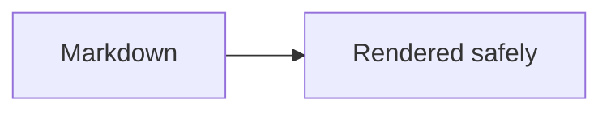

# Security Regression Test

Open this document in MarkdownReader after building the security fix. No dialog,
script, network request, or frame should appear while reviewing it.

## 1. Raw HTML must be inert

The following markup must appear as text and must not execute:

<script>alert("raw script executed")</script>


<iframe src="https://example.com"></iframe>

<object data="file:///C:/Windows/win.ini"></object>

## 2. Unsafe URLs must be neutralized

- [JavaScript link](javascript:alert("javascript link executed"))
- [File link](file:///C:/Windows/win.ini)

Neither link should open a script or local file.


The two images above must remain broken. The document must not display the
contents of either path.

## 3. Supported rendering must still work

Relative local image:


Markdown formatting:

**bold**, *italic*, ~~strikethrough~~, and `inline code`.

Code highlighting and copy controls:

```rust
fn main() {
    println!("MarkdownReader");
}
```

Mermaid rendering:



## Expected result

- The raw HTML examples are visible as inert text.
- No alert appears.
- No iframe or external embedded content loads.
- Unsafe links and images cannot reach scripts, local files, or asset tokens.
- The app icon, syntax highlighting, copy controls, and Mermaid diagram work.
- Tabs, search, scrolling, and external `https://` links continue to behave
  normally.
